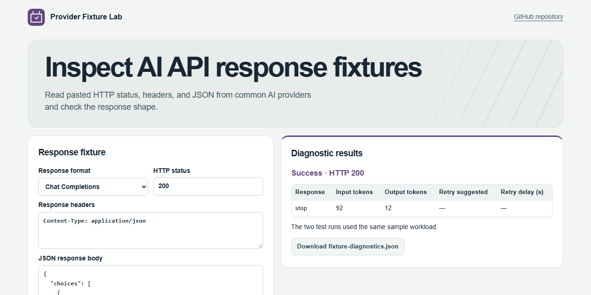

# Provider Fixture Lab

**Inspect AI API response fixtures.** Read pasted HTTP status, headers, and JSON from common AI providers and check the response shape.

[Open the live tool](https://musabukhari237.github.io/provider-fixture-lab/) · [Report an issue](https://github.com/MusaBukhari237/provider-fixture-lab/issues)

[](https://musabukhari237.github.io/provider-fixture-lab/)

## Try it

Choose **Load success example**, then **Inspect fixture**. Paste an HTTP response and choose its format. Sample data uses an invented request and response.

## How it works

Recognizes common non-streaming Chat Completions, Anthropic Messages and Gemini GenerateContent responses. The JSON report contains status, token counts, retry hints and shape checks. Response text stays in the preview, outside the report.

## Run locally

Clone the repo and serve the `docs` folder from localhost.

```sh
python -m http.server 8000 --bind 127.0.0.1 --directory docs
```

Open http://127.0.0.1:8000 in a current browser. Run `node --test` from the repository root with Node.js 22 or later.

## Sponsors

Supported by [LeadCeleris](https://www.leadceleris.com/) and [AIFFICIENTO](https://www.aifficiento.biz/).

## Contributing

Read [CONTRIBUTING.md](CONTRIBUTING.md) and use synthetic fixtures in issue reports. The source is available under the [MIT license](LICENSE).
